# CrackScope

### 基于双目深度相机的裂缝分割与宽度测量

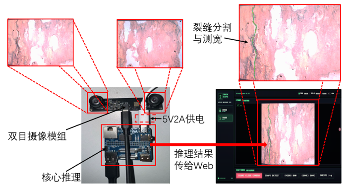

CrackScope 将同步双目相机、立体视觉测距、YOLO 实例分割和网页仪表盘连在一起，在 Raspberry Pi CM4 上演示从左右图像识别裂缝并估算实际宽度的完整流程。仓库包含应用源码、相机标定样例、离线演示数据，以及从硬件搭建到设备部署的说明。

## 目录

- [项目效果](#项目效果)
- [工作流程](#工作流程)
- [硬件组成](#硬件组成)
- [快速开始](#快速开始)
- [实机部署与配置](#实机部署与配置)
- [目录结构](#目录结构)
- [许可说明](#许可说明)

## 项目效果

下面展示一张离线裂缝样例的分割结果。启动项目后可以在仪表盘浏览离线样例；离线模式不需要连接相机、MQTT 或加载模型。

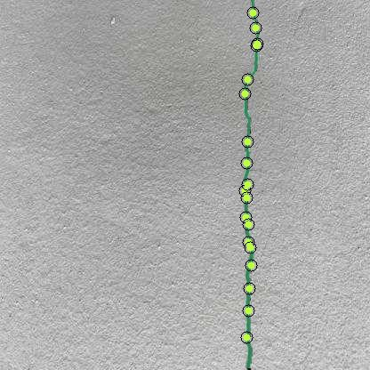

仓库还提供裂缝图像样例，可用于查看离线演示界面：

| 裂缝样例 1 | 裂缝样例 2 | 裂缝样例 3 |
|:---:|:---:|:---:|
| 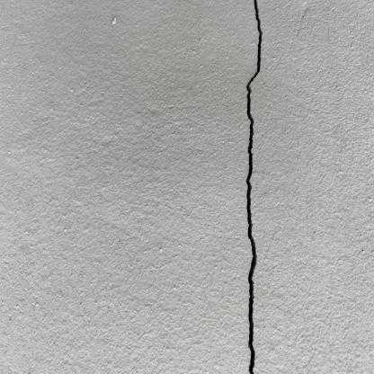 | 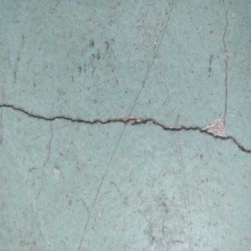 | 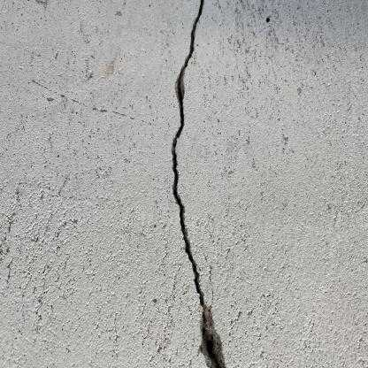 |

## 工作流程

双目相机同步采集左右图像，经校正和视差估计得到深度；YOLO 分割模型定位裂缝并测量像素宽度，再结合深度换算为毫米。FastAPI 服务把处理结果交给网页仪表盘。CM4 设备 Agent 负责相机采集与设备控制；设备控制默认使用本机 HTTP 轮询，MQTT 为可选配置。

```text
同步双目图像 → 校正与视差 → 深度估计
                            ↓
                       YOLO 裂缝分割 → 像素宽度
                                              ↓
                                    深度换算实际宽度（mm）
                                              ↓
                                      FastAPI → 网页仪表盘
```

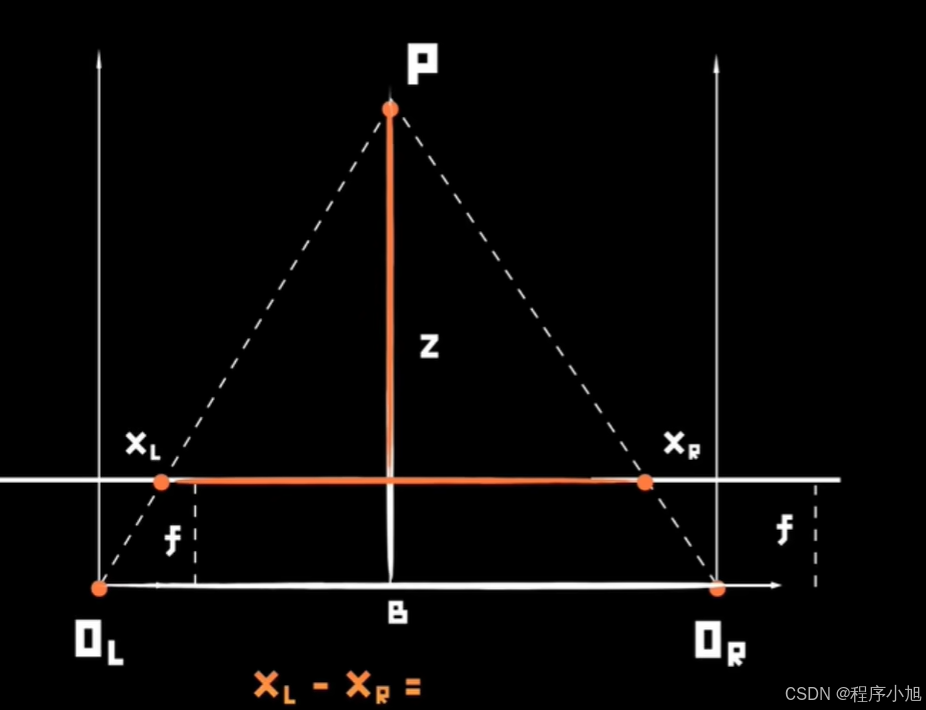

实机测量需要使用与相机匹配的标定参数。下图展示棋盘格角点在左右图像中的检测结果：

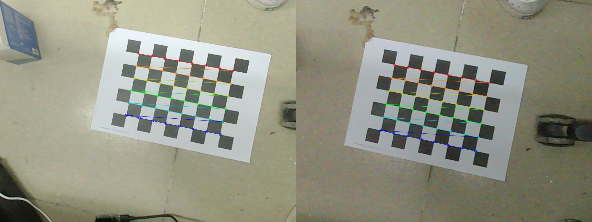

## 硬件组成

项目以 Raspberry Pi CM4、同步双目 USB 相机和 Waveshare CM4-IO-BASE-B 扩展板为例。下方图片展示相机模组和 CM4；其他部件及连接方式见[硬件搭建说明](docs/hardware.md)。

| 双目相机 | Raspberry Pi CM4 |
|:---:|:---:|
| 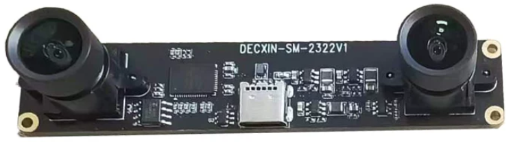 | 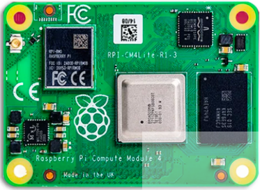 |

| CM4 扩展板 | 散热组件 |
|:---:|:---:|
| 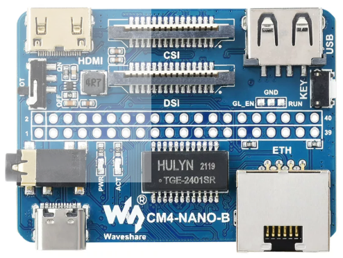 | 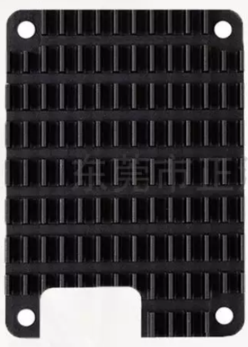 |

## 快速开始

需要 Python 3.9 或更新版本。克隆仓库后，在项目根目录创建并启用虚拟环境。

**Windows PowerShell**

```powershell
python -m venv .venv
.\.venv\Scripts\Activate.ps1
pip install -r requirements.txt
python run.py
```

**Linux / Raspberry Pi OS**

```bash
python -m venv .venv
source .venv/bin/activate
pip install -r requirements.txt
python run.py
```

启动后打开 <http://127.0.0.1:8000>。首次运行可先使用 Demo 模式；它不需要相机、MQTT 或模型权重。

## 实机部署与配置

实机模式需要同步双目相机、该相机对应的标定文件，以及兼容的 YOLO 分割 ONNX 模型。训练权重不随仓库发布；请自行准备模型并按软件说明导出为 ONNX。

- [软件安装、模型导出与本机运行](docs/software.md)
- [相机标定与深度换算](docs/calibration.md)
- [CM4 部署与开机启动](docs/deployment.md)
- [MQTT 可选配置与排错](docs/mqtt.md)

仓库中的标定文件来自一台具体相机，仅作为流程样例。更换相机、镜头焦距或分辨率后，请重新标定。将自己的 Broker 密码、Wi-Fi 密码或令牌放在本地 `.env` 中，不要提交到 Git。

## 目录结构

```text
src/                  FastAPI 服务、双目相机处理和 CM4 Agent
assets/               网页资源、离线演示样例和硬件图片
calibration/          相机标定样例
docs/                 硬件搭建、标定、软件和部署说明
models/               模型目录说明；模型权重由使用者自行准备
scripts/              标定和离线预测辅助脚本
run.py                启动本地仪表盘和 CM4 设备 Agent
```

## 许可说明

项目原创代码和文档采用 [MIT License](LICENSE)。第三方库、图片、模型和其他素材各自遵循其原有许可；详见[第三方素材与依赖记录](THIRD_PARTY_NOTICES.md)。
